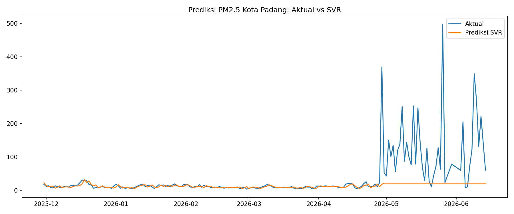

# Prediksi Kualitas Udara PM2.5 Kota Padang Menggunakan Support Vector Regression (SVR)

## Tujuan
Memprediksi konsentrasi PM2.5 harian di Kota Padang menggunakan Support Vector
Regression (SVR), serta membandingkannya dengan pembanding sederhana
("nilai hari ini sama dengan kemarin") untuk menilai apakah model benar-benar
memberi nilai tambah.

## Data
- Sumber: sensor Padang Padang Pasir, West Sumatra (Kementerian Lingkungan Hidup dan Kehutanan)
- Periode: 27 September 2023 sampai 14 Juni 2026 (992 hari, tanpa tanggal hilang)
- Variabel: ringkasan harian dari data per jam (min, max, median, q1, q3, stdev, jumlah pembacaan). Model memakai **median harian** karena lebih tahan terhadap lonjakan sesaat.
- Pembersihan: hari dengan kurang dari 12 pembacaan per jam (32 hari) dianggap kurang andal, nilainya dikosongkan lalu diisi dengan interpolasi linear.

## Metode
1. Fitur: median PM2.5 pada 7 hari sebelumnya (lag 1-7)
2. Pembagian data berdasarkan urutan waktu: 80% latih (sampai 29 Nov 2025) dan 20% uji (30 Nov 2025 sampai 14 Jun 2026, 197 hari)
3. Normalisasi fitur dan target dengan StandardScaler
4. Model: SVR kernel RBF (C = 10, epsilon = 0.1, gamma = "scale"). Parameter belum dituning.
5. Pembanding (baseline): prediksi = nilai hari sebelumnya
6. Evaluasi: MAE, RMSE, MAPE

## Hasil

**Seluruh data uji (197 hari)**

| Model | MAE | RMSE | MAPE |
|-------|-----|------|------|
| SVR | 26,40 | 69,22 | 40,8% |
| Baseline (kemarin) | 26,16 | 71,54 | 65,8% |

**Hari dengan PM2.5 normal, median <= 50 (159 hari)**

| Model | MAE | RMSE | MAPE |
|-------|-----|------|------|
| SVR | 3,64 | 5,24 | 31,6% |
| Baseline (kemarin) | 8,52 | 41,89 | 62,7% |

## Interpretasi
- Pada hari dengan PM2.5 normal, SVR jauh lebih baik daripada baseline (MAE 3,64 vs 8,52).
- Pada seluruh data uji, SVR dan baseline hampir setara. Penyebabnya, periode uji memuat lonjakan PM2.5 yang jauh melampaui rentang data latih (nilai tertinggi di data latih 57,96, sedangkan di data uji mencapai 497,25). Model tidak dapat memprediksi nilai di luar rentang yang pernah dilihatnya.
- Ambang 50 dipilih setelah melihat data, sebagai cara memisahkan hari normal dari hari lonjakan. Hasil pada bagian ini bukan hasil uji murni pada data yang tidak pernah dilihat.

## Keterbatasan
- 24 hari dengan median di atas 100 (semuanya April-Juni 2026) belum diverifikasi apakah kejadian nyata atau gangguan sensor.
- Parameter SVR belum dituning, dan jumlah lag (7) dipilih tanpa pengujian alternatif.
- Model hanya memakai nilai PM2.5 sebelumnya, belum memakai variabel cuaca.
- Hanya satu sensor dan satu pembagian data latih/uji.

## Tools
Python, Google Colab, Pandas, NumPy, Matplotlib, Scikit-learn

## File di Repositori
- `proyek_PM2_5_metode_SVR.ipynb`: notebook analisis
- `data_pm25_padang.csv..csv`: data harian PM2.5
- `hasil_prediksi.png`: grafik hasil prediksi
